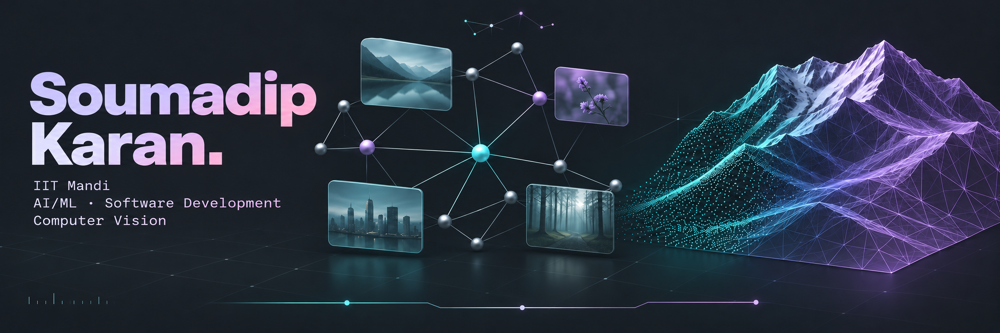
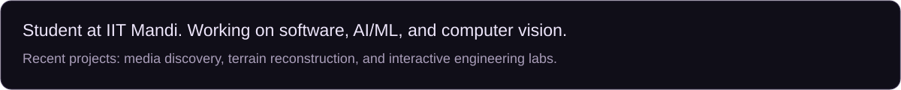
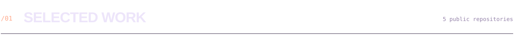
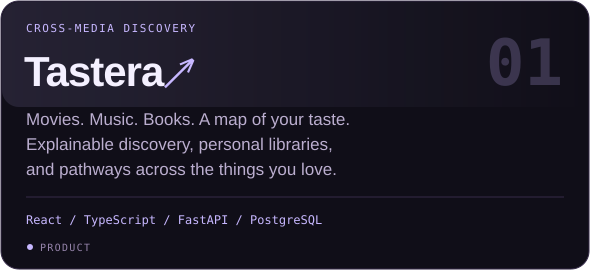
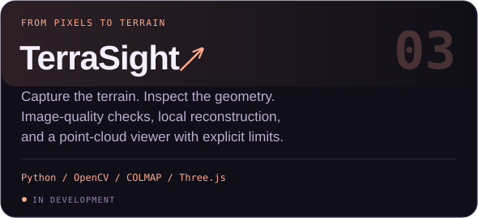
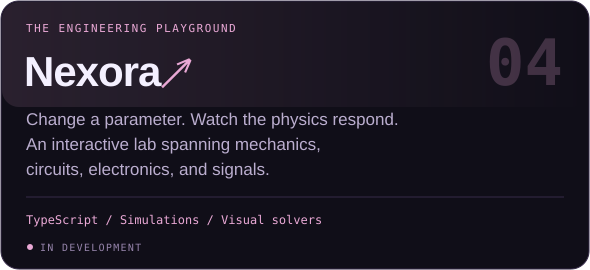
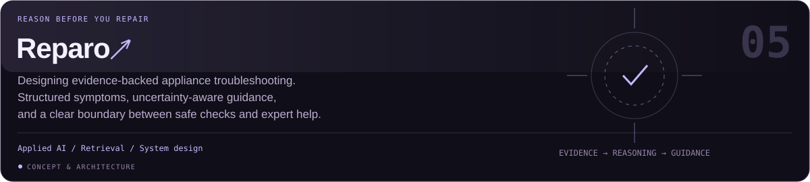
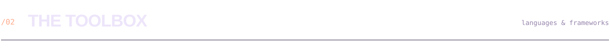
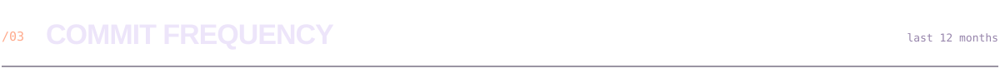
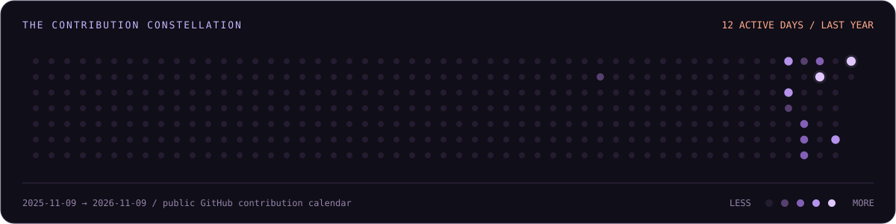

 

 

  

  

<b>UNDER THE HOOD</b> &nbsp; NumPy · OpenCV · COLMAP · Three.js · Jupyter

<b>ON MY RADAR</b> &nbsp; Computer vision · Recommendation systems · Numerical methods

 

  

Public data only. Language share measures code bytes, not proficiency.

 

