 

 &nbsp;
 &nbsp;
 &nbsp;

 
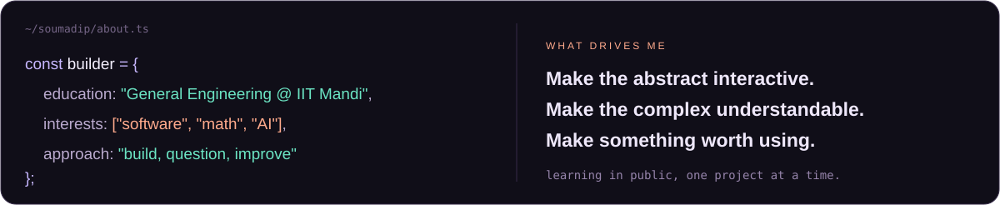
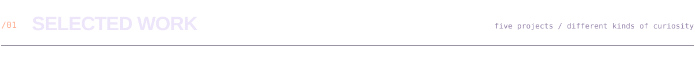

<a href="https://github.com/souma888/Tastera">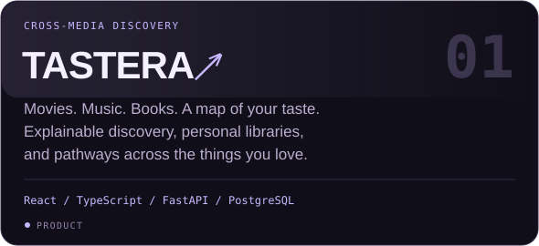</a>
<a href="https://github.com/souma888/Vectora">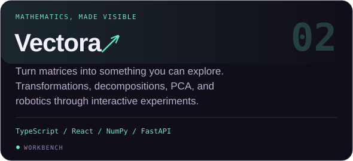</a>
  
<a href="https://github.com/souma888/TerraSight">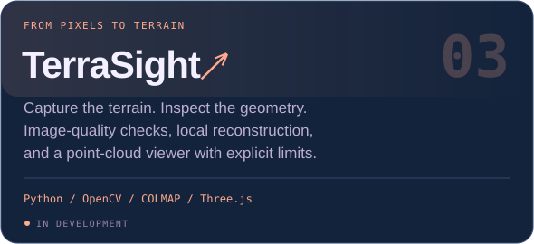</a>
<a href="https://github.com/souma888/Nexora">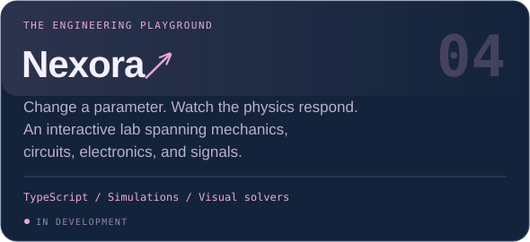</a>
  

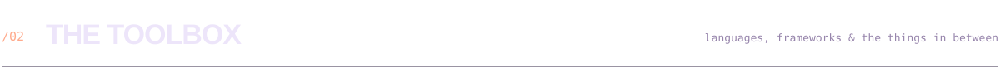

<b>UNDER THE HOOD</b> &nbsp; NumPy · OpenCV · COLMAP · Three.js · Jupyter

<b>ON MY RADAR</b> &nbsp; Computer vision · Recommendation systems · Numerical methods

 
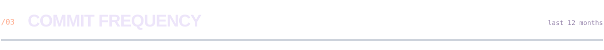
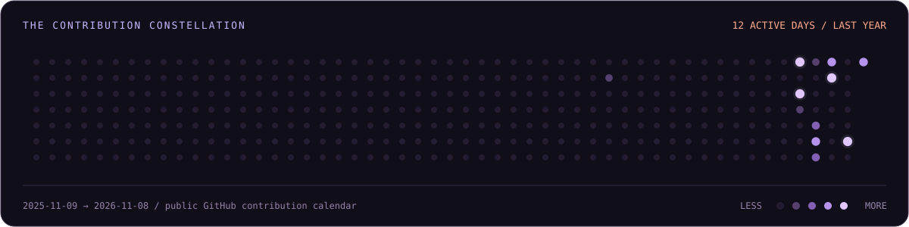
  
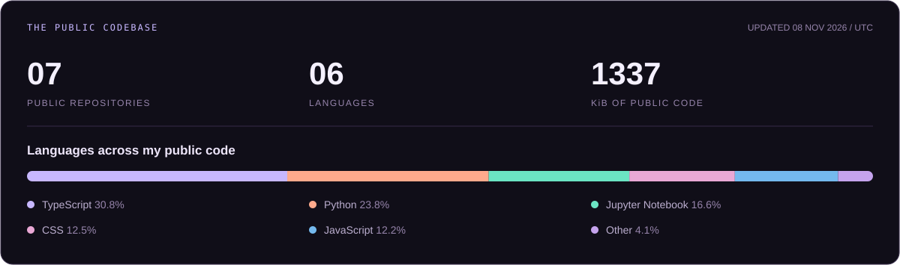

Public data only. Language share measures code bytes, not proficiency.

 

